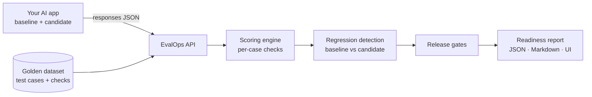

# EvalOps AI

**Release gating for LLM applications.** EvalOps AI scores the responses an AI application produces against a golden dataset. It compares a candidate model or prompt version with the version in production, flags regressions case by case, and produces a release-readiness report with an explicit pass/fail decision.

It is built for the moment a team asks, *"Can we ship the cheaper model / the new prompt?"*, and needs evidence rather than a vibe check.



## What it does

| Capability | Details |
|---|---|
| Datasets and test cases | CRUD, bulk import, per-case checks: reference answer, required terms, forbidden terms, JSON Schema, latency limit, tags |
| Scoring | Normalized exact match, token precision/recall/F1, term checks, JSON Schema validation, latency limits, pass rates overall and per tag |
| Comparison | Compatibility checks first (same scoring config, methodology version and per-case definitions), then aggregate metric deltas over comparable cases and per-case `regressed` / `fixed` / `f1_drop` classification. Incomparable runs are reported as such, never as regressions |
| Versioning | Dataset and test-case versions with definition hashes; each result snapshots the definition it was scored against; runs record the scoring-methodology version |
| Release gates | Configurable thresholds; comparison gates **fail closed** when no baseline is supplied |
| Reports | Readiness verdict, gate table, regression summary, failing cases; JSON or Markdown |
| UI | Overview, datasets, new evaluation, run history, run detail, compare, release reports |

## RAG evaluation with free local models

EvalOps also evaluates **retrieval-augmented assistants**. A fictional policy knowledge base (20 passages, 20 customer questions) is answered by **Qwen2.5-1.5B running locally with MLX** on an 8 GB M2. EvalOps then checks:

- **Deterministic:** retrieval recall@k and MRR, citation existence and validity, claim-level lexical groundedness against the retrieved passages (with exact-number matching), and whether the assistant declines unanswerable questions.
- **Estimated:** a separate **Llama-3.2-3B judge** grades each claim. Its verdicts are stored, compared and gated as a clearly labelled *estimated* category that never changes deterministic results.

Real result: a "friendlier" candidate prompt **regressed** groundedness from 0.78 to 0.52 and invented a showroom's opening hours and UK shipping. EvalOps flagged 7 regressed cases and blocked the release.

The judge's agreement with a labelled set of 96 claims was measured rather than assumed. On held-out real answers it scored κ = 0.34 (vs 0.62 overall and 0.78 held-out for the lexical heuristic), and these labels are still unreviewed drafts. Details, benchmarks (1.5B: ~80 tok/s, 1.48 GB peak; 3B judge: 2.54 GB peak) and limitations are in [docs/rag-evaluation.md](docs/rag-evaluation.md).

```bash
make rag-demo        # replays the recorded model answers and judge verdicts; no model needed
make setup-local-ai  # optional: install MLX (~400 MB) to regenerate with local models
```

## What it does *not* do

EvalOps AI measures **lexical overlap and structural conformance**. It does **not** verify factual correctness or detect hallucinations. A fluent wrong answer can score well on token F1. Use these metrics as regression signals, and pair them with human review of failing and borderline cases. See [docs/evaluation-methodology.md](docs/evaluation-methodology.md).

EvalOps AI also never calls a model. You submit outputs your application already produced, so it costs nothing to run and works with any provider.

## Quick start

Requirements: Python 3.12+ (3.13 tested), Node 20+ (25 tested), macOS/Linux. No Docker, no API keys, no paid services.

```bash
make setup        # creates backend/.venv, installs Python + npm deps (project-local)
make backend      # API on http://127.0.0.1:8000  (OpenAPI docs at /docs)
make frontend     # UI  on http://127.0.0.1:5173   (in a second terminal)
make seed         # loads the fictional Kestrel Home Goods demo through the API
```

Then open http://127.0.0.1:5173 and go to **Release reports**. Pick run #2 as the candidate and run #1 as the baseline.

Configuration is optional; copy `.env.example` to `.env` to override the defaults (database path, CORS origins, body size limit, API URL for the UI).

## Using it with your own app

1. Create a dataset and test cases (UI, `POST /datasets/{id}/test-cases/bulk`, or import a JSON file shaped like [examples/datasets/kestrel_support_v1.json](examples/datasets/kestrel_support_v1.json)).
2. Run your application on each test case input and record `output` and `latency_ms`.
3. Submit them as a run:

```bash
curl -X POST http://127.0.0.1:8000/evaluations/runs -H 'Content-Type: application/json' -d '{
  "dataset_id": 1, "model_name": "my-model", "prompt_version": "v2",
  "config": {"min_token_f1": 0.5, "default_max_latency_ms": 2500},
  "responses": [{"case_key": "policy-return-window", "output": "...", "latency_ms": 840}]
}'
```

4. Gate the release, for example from CI:

```bash
curl -s -X POST http://127.0.0.1:8000/evaluations/gates -H 'Content-Type: application/json' -d '{
  "candidate_run_id": 2, "baseline_run_id": 1,
  "gates": {"min_pass_rate": 0.9, "max_forbidden_violations": 0, "max_regressed_cases": 0}
}' | jq -e '.decision == "pass"'
```

## API

| Method | Path | Purpose |
|---|---|---|
| GET | `/health` | Liveness + database check |
| GET, POST | `/datasets` | List / create datasets |
| GET, PATCH, DELETE | `/datasets/{id}` | Read / update / delete (409 if runs exist) |
| GET, POST | `/datasets/{id}/test-cases` | List / create a test case |
| POST | `/datasets/{id}/test-cases/bulk` | Atomic bulk create |
| GET, PATCH, DELETE | `/test-cases/{id}` | Read / update / delete a test case |
| POST | `/evaluations/runs` | Score a set of responses and store the run |
| GET | `/evaluations/runs` | Run history (filters: `dataset_id`, `model_name`, `prompt_version`; paging) |
| GET, DELETE | `/evaluations/runs/{id}` | Run with per-case results / delete |
| GET | `/evaluations/runs/{id}/report` | Release-readiness report (`baseline_run_id`, `format=json\|markdown`) |
| GET | `/evaluations/compare` | `baseline_run_id` vs `candidate_run_id`, with tolerances |
| POST | `/evaluations/gates` | Evaluate a custom gate policy |

Errors always use `{"error": {"code", "message", "details?"}}`. Interactive docs are at http://127.0.0.1:8000/docs.

## Testing and quality

```bash
make test     # backend pytest (unit, integration, migration, golden-score regression) + frontend vitest
make lint     # ruff, ruff format --check, tsc --noEmit, eslint
make check    # both
```

- **Golden-score regression tests** pin the engine's exact output on the committed fixtures, so an accidental change to the methodology fails CI.
- A migration test fails if ORM models drift from the Alembic migrations, and another upgrades a legacy database to verify existing data is preserved and backfilled.
- Regression tests in `tests/regression/test_comparison_validity.py` reproduce two former bugs (config changes and dataset edits misreported as model regressions).
- Pytest treats warnings as errors.

## Project layout

```
backend/
  evalops/
    engine/        pure scoring, regression, and gate logic (no I/O)
    repositories/  SQLAlchemy persistence
    services/      business rules, reporting
    api/           FastAPI routers and dependencies
    schemas.py     Pydantic request/response contract
  migrations/      Alembic
  scripts/seed_demo.py
frontend/src/      React + TypeScript (Vite), pages/, components/, api/
examples/          fictional dataset + three response sets
tests/             unit/, integration/, regression/
docs/              architecture, methodology, customer scenario, demo script, roadmap
```

## Documentation

- [Architecture](docs/architecture.md)
- [Evaluation methodology](docs/evaluation-methodology.md)
- [Customer scenario](docs/customer-scenario.md): Kestrel Home Goods (fictional)
- [RAG evaluation with local models](docs/rag-evaluation.md): methodology, judge calibration, benchmarks
- [Five-minute demo script](docs/demo-script.md)
- [Roadmap](docs/roadmap.md)

## License

MIT. See [LICENSE](LICENSE). All company names, people, orders and model names in the examples are fictional.
