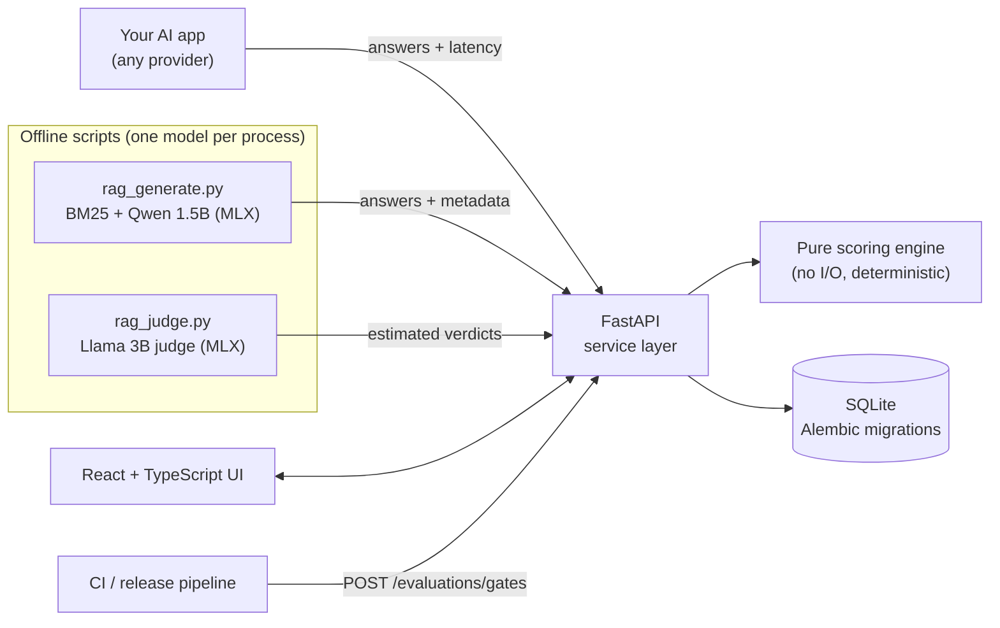

# EvalOps AI

**Release gating for LLM applications.** EvalOps scores the answers an AI application produces,
compares a candidate model or prompt with what's in production, explains every regression case by
case, and returns a go/no-go decision against a release policy agreed in advance.

It is built for the question every AI team gets asked before a change ships: *"Is the new prompt
or the cheaper model actually safe to release?"*


> Local, single-user portfolio project. It runs on a laptop, uses free local models, and has no
> authentication. See [Limitations](#limitations) for the scope and deployment limits.

## The problem

Teams change prompts and models constantly, but most releases are judged by reading a few
answers. That misses the failures that matter in customer-facing assistants:

- a "friendlier" prompt that starts **inventing policies** the company never wrote,
- a cheaper model that wraps JSON in prose and **breaks a downstream parser**,
- an assistant that **promises compensation** it isn't allowed to give.

EvalOps turns those concerns into explicit, versioned checks, runs them the same way every time,
and blocks the release when a predefined gate fails.

## What it does

| | |
|---|---|
| **Deterministic checks** | Exact match, token F1, required/forbidden terms, JSON Schema, latency; for RAG: retrieval recall@k and MRR, citation validity, claim-level lexical groundedness, abstention on unanswerable questions |
| **Regression detection** | Baseline vs candidate, per case (`regressed`, `fixed`, …) and per metric with tolerances. Refuses to compare runs that used a different scoring config, knowledge base or test-case definition |
| **Release gates** | Thresholds agreed in advance; comparison gates fail closed; JSON and Markdown readiness reports |
| **Local AI (optional)** | Qwen2.5-1.5B generates answers and Llama-3.2-3B judges claims, both via MLX on Apple Silicon. Model scores are separate, labelled *estimated*, and excluded from deterministic case results and default gates |
| **Reproducibility** | Methodology versioning, test-case definition hashes, generation metadata (model revision, prompt hash, decoding settings), recorded outputs replayed in tests |

## Architecture



The API never loads a model. Scoring is a pure, deterministic engine, and model-based judging is an
optional offline step whose results are stored and shown separately. More detail:
[docs/architecture.md](docs/architecture.md).

## Measured results

### 1. Support assistant: cheaper model + new prompt (fixture data)

| Run | Passed | Forbidden-term violations | JSON schema | Verdict |
|---|---|---|---|---|
| Production baseline | 11/12 | 0 | 100% | baseline |
| Candidate (cheaper model, concise prompt) | 8/12 | 2 | 33% | **NOT READY**: 4 regressed cases |
| Candidate after prompt fixes | 12/12 | 0 | 100% | **READY** |

These responses are hand-written fixtures that illustrate the gating workflow ([scenario](docs/customer-scenario.md)).

### 2. Policy assistant (RAG) with real local-model answers

20 questions (3 deliberately unanswerable) over 20 fictional policy passages. Answers generated on
a MacBook Air M2 (8 GB) by Qwen2.5-1.5B-Instruct (4-bit, temperature 0); same retriever, decoding
and **predefined** release policy for every prompt. All three recordings below were rescored
under methodology **1.3.0** against the same dataset, retrieved passages, and scoring configuration.

These are verified **working-tree results**. The v3 implementation, recordings, and methodology
1.3.0 change remain uncommitted and are not included in this documentation update.

| Prompt | Passed | Groundedness (lexical) | Citation validity | Abstention accuracy | Release verdict |
|---|---|---|---|---|---|
| `rag-v1` production | 9/20 | 0.78 | 0.90 | 0.90 | NOT READY: 2 of 6 applicable gates pass |
| `rag-v2` "friendlier" | 3/20 | 0.52 | 0.92 | 0.85 | **NOT READY**: 7 regressed cases; invented showroom hours and UK shipping |
| `rag-v3` targeted fixes | 9/20 | 0.80 | **1.00** | 0.85 | **NOT READY**: 5 gates pass, 3 fail, 1 is skipped; answers all 3 unanswerable questions |

`rag-v3` reaches the citation-validity and lexical-groundedness gates but still passes only
**9/20 cases (45%)**. Against `rag-v1`, it fails exactly three default release gates:
`min_pass_rate` (45% < 90%), `min_abstention_accuracy` (85% < 100%), and
`max_regressed_cases` (3 > 0). Thresholds were not changed. Three cases improve and three regress;
p95 latency also regresses from 965 ms to 1,219 ms, exceeding the comparison's 20% tolerance.

**100% citation validity is not complete citation coverage:** four v3 answers have no citations,
and citation support is 83.3%. All three unanswerable questions are answered rather than declined.
Methodology 1.3.0 adds a `content` failure for non-abstaining answers with no checkable statement,
including citation-only output. This changes v3's citation-only mattress answer from pass to fail
(10/20 under 1.2.0 becomes 9/20 under 1.3.0); v1 and v2 scores are unchanged. Details:
[docs/rag-evaluation.md](docs/rag-evaluation.md).


The screenshot shows the local demo database (v1 stored under 1.2.0, v3 under 1.3.0);
the table above uses same-version rescoring. The UI counts all nine gates, including the skipped
schema gate, so it displays five passed out of nine.

### 3. How far to trust the checks (provisional)

| Verifier (positive = unsupported claim) | Cohen's κ, all 91 claims | κ, held-out claims for judge development |
|---|---|---|
| Lexical groundedness heuristic | 0.62 | 0.78 |
| Llama-3.2-3B judge (`judge-v2`) | 0.45 | 0.34 |

> **Label review is incomplete; calibration is provisional.** The 96 labels were drafted by the
> developer. In the audited working tree, **5 have been human-reviewed and 91 are unreviewed drafts**. Four
> rows carry AI recommendations, stored separately and *not* counted as labels. No label has been
> independently validated, and the numbers above were measured against drafts. The local 3B judge
> is therefore shown only as an *estimate* and is excluded from the default gates. The held-out
> claims concern judge development on v1/v2 answers; they are not held-out questions validating v3.

### 4. Local model performance (MacBook Air M2, 8 GB)

| | Qwen2.5-1.5B (generation) | Llama-3.2-3B (judge) |
|---|---|---|
| Download / on disk | 0.88 GB / 839 MB | 1.82 GB / 1.7 GB |
| Peak memory footprint | 1.44–1.59 GB | 2.52–2.54 GB |
| Speed | ~80 tokens/s; p50 0.63–0.82 s per answer | ~0.7–1.1 s per claim |

Models run one at a time; the API process holds no weights.


## Quick start

Requirements: macOS or Linux, Python 3.13 (3.12+ declared, only 3.13 tested), and Node 22.12+
(CI uses Node 22; local verification used Node 25). Ensure `python3` selects Python 3.13 before
`make setup`. No Docker, API keys, or paid services are needed for replay and testing.

```bash
make setup          # hash-verified Python tooling/dev dependencies + npm ci
make backend        # API on http://127.0.0.1:8000  (OpenAPI docs at /docs)
make frontend       # UI  on http://127.0.0.1:5173   (second terminal)
make seed           # support-assistant demo (12 cases, 3 runs)
make rag-demo       # RAG demo: replays the recorded Qwen answers + judge verdicts (no model needed)
```

Then open **Compare** (baseline `rag-v1`, candidate `rag-v2` or `rag-v3`) and **Release reports**.
V3 replay requires the pending working-tree implementation and recordings noted above. Seeding
adds runs to the local database; it does not rewrite the recorded examples.

Optional, Apple Silicon only, to regenerate answers with local models (~400 MB of packages plus
2.7 GB of model downloads, which you start yourself):

```bash
make setup-local-ai
backend/.venv/bin/python -c "from huggingface_hub import snapshot_download as d; \
  [d(m) for m in ('mlx-community/Qwen2.5-1.5B-Instruct-4bit', 'mlx-community/Llama-3.2-3B-Instruct-4bit')]"
make rag-generate && make rag-demo-live  # overwrites recordings/grades; unnecessary for replay
```

A 3-minute walkthrough is in [docs/demo-3-minute.md](docs/demo-3-minute.md).

## Testing

| Suite | Command | Verified working-tree result |
|---|---|---|
| Backend: unit, integration, migration, golden regression | `make test-backend` | 233 passed |
| Frontend unit (Vitest) | `make test-frontend` | 24 passed |
| End-to-end (Playwright, real API + UI, throwaway DB) | `make e2e` | 18 passed (1 setup + 17 browser scenarios) |
| Lint / format / types | `make lint` | ruff, ruff format, tsc, ESLint clean |

For browser tests, run `make e2e-install` once to install matching Chromium, then `make e2e`.
No AI model download is involved. [Browser test setup](docs/e2e.md) documents Linux dependencies
and the isolated API/UI startup. `make check` runs lint, unit/integration tests, and the frontend
build; Playwright is a separate command.

The committed Phase 4 Task 2 baseline (`3e94d11`) passed **227 backend, 24 frontend, and 17
Playwright tests**. The working-tree counts above include the pending v3/methodology tests and
v3 recording; they do not describe a documentation-only checkout.

GitHub Actions ([.github/workflows/ci.yml](.github/workflows/ci.yml)) runs the same jobs on Ubuntu.
The workflow is committed but has **not yet run on GitHub**: the repository has never been pushed.
The CI install path (fresh venv from `requirements/dev.lock` with `--require-hashes`, no MLX) was
verified locally.

## Technical decisions

| Decision | Why |
|---|---|
| Score recorded outputs; never call models from the API | Provider-agnostic, deterministic, free; generation is a separate, replaceable step |
| Pure scoring engine | Reproducible scores, unit-testable, reusable from CI |
| Fail-closed gates | A gate that passes because data was missing is worse than no gate |
| Comparison compatibility checks | A config change or an edited test case must never look like a model regression |
| Methodology semver + definition hashes | Old runs stay interpretable when rules evolve |
| Lexical heuristic gates, model judge as estimate | The judge was measured: it disagreed with labels too often to gate on |
| One model per process, MLX 4-bit | Fits an 8 GB machine with a browser and editor open |
| SQLite + SQLAlchemy + Alembic | Zero-ops locally; a path to Postgres without rewriting |
| Hash-pinned lockfiles, MLX in a separate lock | Reproducible CI without Apple-only packages |

## Limitations

- **Local and single-user:** no authentication, roles or audit log. Not production infrastructure; keep it on a trusted local machine.
- **Small evaluation sets** (12 and 20 cases, 91 labelled claims); wide confidence intervals.
- **Labels are mostly unreviewed drafts**; calibration is provisional (see above).
- **Lexical checks ≠ correctness:** they don't understand paraphrase or negation, and a grounded
  sentence can still be the wrong answer to the question. Nothing here detects hallucinations in
  general; groundedness is measured against the retrieved passages only.
- **One generator and one judge model**, both small; BM25 retrieval misses vocabulary mismatches.
- **Weak abstention:** v3 answers all three unanswerable questions; 85% accuracy is over all 20 cases, not the unanswerable subset.
- **Missing citations:** four v3 answers have none despite 100% validity of the citations that are present.
- **Imperfect judge calibration:** held-out claim precision is 0.42 and κ is 0.34; these draft-label results do not justify default judge gating.
- `rag-v3` was designed after seeing failures on the same 20 questions; there is **no held-out question-set validation** of v3.

## Documentation

[Architecture](docs/architecture.md) · [Evaluation methodology](docs/evaluation-methodology.md) ·
[RAG evaluation & calibration](docs/rag-evaluation.md) · [Labeling guideline](docs/labeling-guideline.md) ·
[Customer scenario](docs/customer-scenario.md) · [3-minute demo](docs/demo-3-minute.md) ·
[5-minute demo](docs/demo-script.md) · [Roadmap](docs/roadmap.md) · [CI](docs/ci.md) ·
[Browser tests](docs/e2e.md)

## License

MIT. All companies, people, orders, policies and questions in the examples are fictional.
