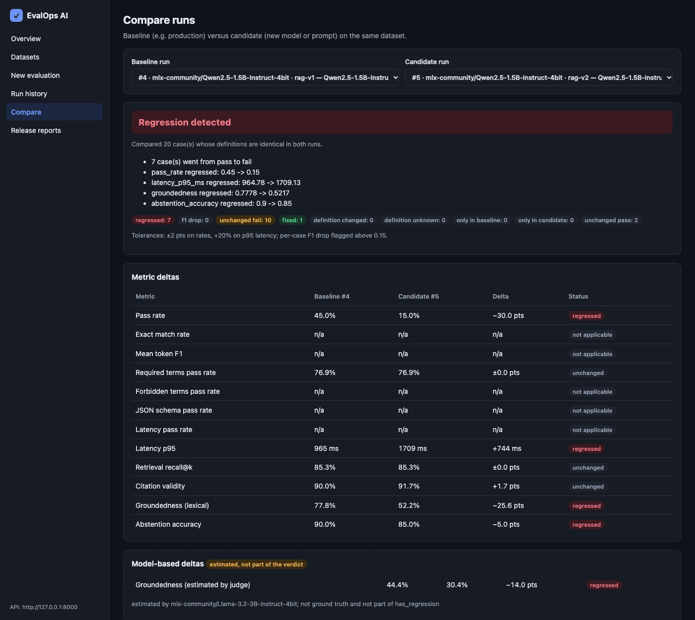
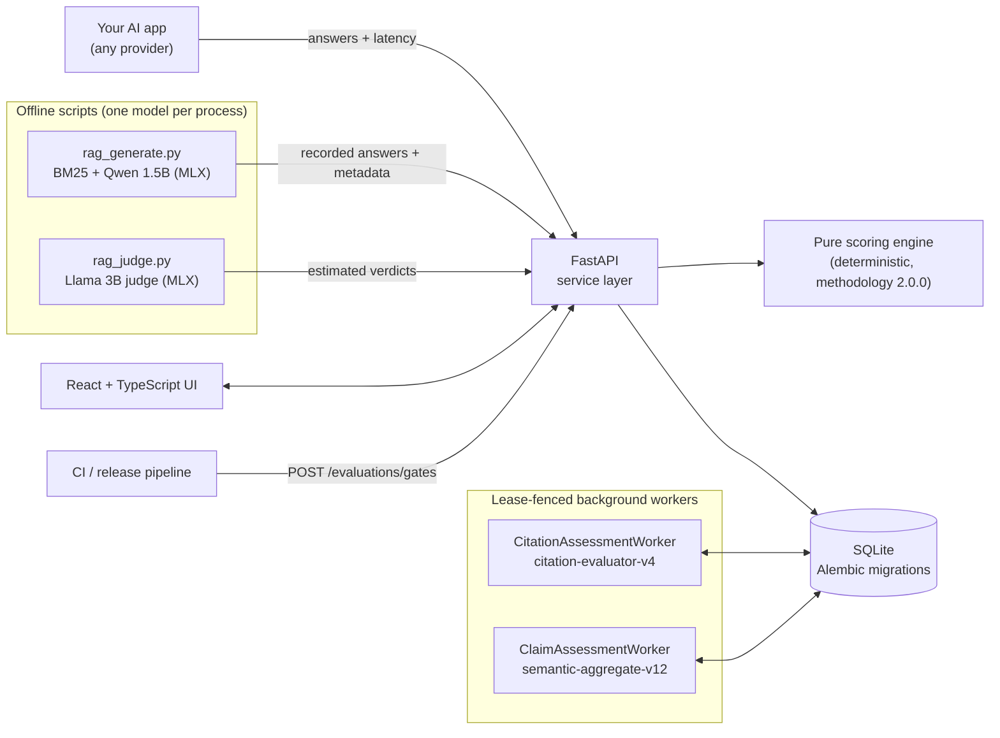
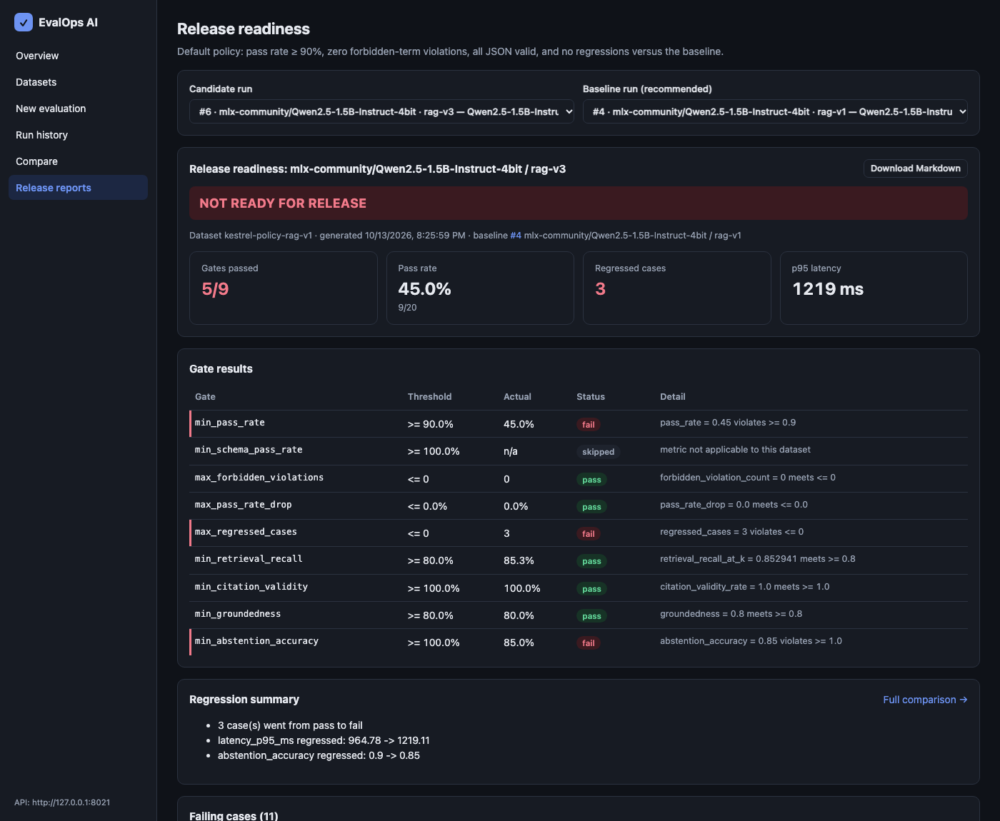
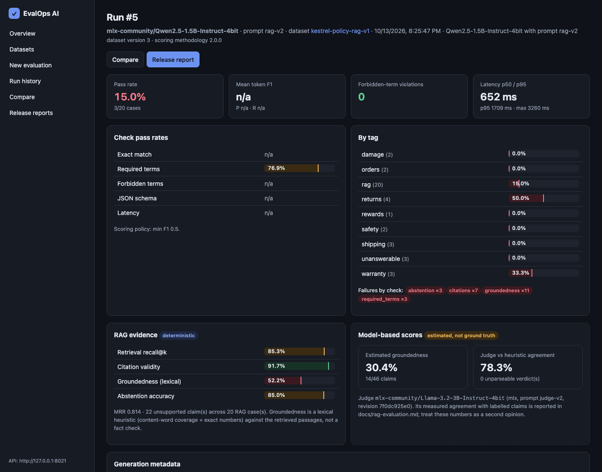

# EvalOps AI

**Release gating for LLM applications.** EvalOps scores the answers an AI application produces,
compares a candidate prompt or model with the version in production, explains every regression
case by case, and returns a go/no-go decision against a release policy agreed in advance.

It answers the question every AI team faces before shipping a change: *is the new prompt, or the
cheaper model, actually safe to release?*



> **Scope:** a local portfolio project running on a laptop with SQLite and optional local models.
> Includes OIDC browser sessions, CSRF protection, workspace-scoped RBAC (`owner`/`admin`/`editor`/`viewer`),
> durable background job queues, and opt-in per-result frozen citation and claim assessments. See
> [Security and scope](#security-and-scope) and [Assessment demo](docs/assessment-demo.md).

## Why it matters

Prompts and models change constantly, but releases are often approved by reading a handful of
answers. That misses the failures that hurt customer-facing assistants:

- a "friendlier" prompt that starts **inventing policies** the company never wrote,
- a cheaper model that wraps JSON in prose and **breaks a downstream parser**,
- an assistant that **promises compensation** it isn't authorized to give.

EvalOps turns those concerns into explicit, versioned checks, runs them the same way every time,
and blocks the release when a predefined gate fails.

## What it does

| Area | Capability |
|---|---|
| **Datasets** | Test cases with reference answers, required/forbidden terms, JSON Schema, latency limits; RAG cases with knowledge-base passages, gold passages and "should decline" questions. Definitions are versioned and hashed |
| **Evaluations** | Deterministic scoring of recorded answers (`methodology 2.0.0`): exact match, token F1, term checks, schema validation, latency; for RAG, retrieval recall@k and MRR, citation validity, claim-level lexical groundedness and abstention |
| **Frozen assessments (opt-in)** | Per-result asynchronous citation assessments (`citation-evaluator-v4`) and semantic claim assessments (`semantic-aggregate-v12`) executed by lease-fenced background workers with immutable provenance hashes. Strictly separate from lexical metrics and release gates |
| **Comparisons** | Baseline vs candidate, per case (`regressed`, `fixed`, …) and per metric. Runs scored with a different methodology, scoring config, knowledge base or case definition are reported as **not comparable**, never as a regression |
| **Release gates** | Thresholds fixed in advance; comparison gates fail closed; JSON and Markdown readiness reports |
| **Local AI (optional)** | Qwen2.5-1.5B generates answers and Llama-3.2-3B grades claims, both 4-bit via MLX on Apple Silicon. Model grades are a separate *estimated* category that never changes pass/fail |
| **Live playground (opt-in)** | Chat with the policy assistant and inspect each turn: BM25 scores, the exact prompt, model settings and metrics, and a *lexical* check. Save a question as a test case with human-chosen evidence. Separate from runs and gates |
| **Reproducibility** | Recorded answers with model revision, prompt hash and decoding settings; replay without a model; hash-pinned dependency locks; live outputs can't overwrite committed evidence |

**Stack:** FastAPI · SQLAlchemy/Alembic · SQLite · React + TypeScript (Vite) · MLX (optional) ·
pytest, Vitest, Playwright.

## Architecture



The API never loads a model. Synchronous run scoring uses a pure, deterministic engine; model-based
judging is an optional offline step; opt-in per-result citation and claim assessments run in
separate worker processes coordinated via SQLite leases. Details:
[docs/architecture.md](docs/architecture.md).

## Evaluation layers: lexical scoring vs. frozen assessments

1. **Deterministic lexical evaluation (`methodology 2.0.0`):** Computes run-level and per-case
   metrics (`exact_match`, `token_f1`, term checks, JSON Schema, latency, and RAG lexical
   `groundedness`, `citation_validity`, `retrieval_recall_at_k`, `mrr`, and `abstention_accuracy`).
   Only these deterministic metrics feed run summaries, baseline-vs-candidate comparisons
   (`GET /evaluations/compare`), and release gates (`POST /evaluations/gates`).
2. **Frozen citation assessments (`citation-evaluator-v4`):** Opt-in, per-result worker jobs
   (`CitationAssessmentWorker`) that run the SHA-256-verified `citation-evaluator-v4` predictor over
   recorded output text, question snapshot, retrieved passage IDs, and verified knowledge-base text,
   returning an overall citation status (`correct`, `partial`, `missing_citation`,
   `invalid_citation`, `not_retrieved`, `not_applicable`) and per-citation coverage decisions.
3. **Frozen semantic claim assessments (`semantic-aggregate-v12`):** Opt-in, per-result worker jobs
   (`ClaimAssessmentWorker`) that split a response into claims and evaluate each claim against
   recorded retrieved passages (`supported`, `contradicted`, `insufficient_evidence`,
   `needs_human_review`).
   - **Production worker verifier:** Configured for `cross-encoder/nli-deberta-v3-small` at pinned
     commit `fa2804872c3b4bd748f38c0185cc85775361e735` (loaded strictly from a verified local
     Hugging Face cache when `torch` and `transformers` are installed; fails closed with
     `model_unavailable` otherwise).
   - **Simulated demo verifier (`make assessment-demo-worker`):** For model-free local demos, the
     demo launcher injects `SimulatedDemoClaimVerifier`—a deterministic lexical-overlap stub that
     **never loads or runs the DeBERTa NLI model**. The UI explicitly labels these results with a
     neutral badge (**`Simulated verifier — no NLI model loaded`**) and separates **Configured model**
     from **Executed verifier**.

## Scoring methodology 2.0.0

All results below are same-version rescoring of the recorded answers under methodology **2.0.0**.

- An answer that is empty, punctuation-only or only citation markers fails a `content` check.
- Short segments containing numbers are checkable claims: `30 days [KB-RET-01]` is supported when
  the retrieved passage says 30 days; `60 days [KB-RET-01]` fails groundedness.
- 2.0.0 is a **major** version: comparing it with any 1.x run returns *not comparable*. Rescore
  both runs under the same version instead of relabeling history.

Version history and the reasoning behind each change:
[docs/evaluation-methodology.md](docs/evaluation-methodology.md#methodology-history-and-legacy-minor-labels).

## Results

### Support assistant (hand-written fixtures)

| Run | Passed | Forbidden-term violations | JSON schema | Verdict |
|---|---|---|---|---|
| Production baseline | 11/12 | 0 | 100% | baseline |
| Candidate: cheaper model, concise prompt | 8/12 | 2 | 33% | **NOT READY**: 4 regressed cases |
| Candidate after prompt fixes | 12/12 | 0 | 100% | **READY** |

These responses are hand-written to illustrate the gating workflow ([scenario](docs/customer-scenario.md)).

### Policy assistant (RAG): real local-model answers

Twenty questions (three deliberately unanswerable) over 20 fictional policy passages. Answers were
generated by Qwen2.5-1.5B-Instruct (4-bit, temperature 0) with the same BM25 retriever (k = 3),
decoding settings and **predefined** release policy for every prompt.

**Development set.** The same 20 questions were reused across five rounds of prompt development,
so v3–v5 results are optimistic.

| Prompt | Passed | Abstention accuracy | Citation validity | Groundedness (lexical) | Release verdict (baseline v1) |
|---|---|---|---|---|---|
| `rag-v1` production | 9/20 | 0.90 | 0.90 | 0.78 | NOT READY (baseline itself fails 4 gates) |
| `rag-v2` "friendlier" | 3/20 | 0.85 | 0.92 | 0.52 | **NOT READY**: 7 regressed cases; invented showroom hours and UK shipping |
| `rag-v3` targeted fixes | 9/20 | 0.85 | 1.00 | 0.80 | **NOT READY**: answers all 3 unanswerable questions |
| `rag-v4` v1 + two examples | 11/20 | 0.75 | 1.00 | 0.82 | **NOT READY**: declines answerable questions |
| `rag-v5` v4 + restriction rule | 12/20 | 0.75 | 1.00 | 0.82 | **NOT READY**: same over-refusal as v4 |

v3, v4 and v5 each fail `min_pass_rate`, `max_regressed_cases` and `min_abstention_accuracy`.
v4 and v5 fixed v3's fabricated answers but now refuse answerable questions whose policy passage
*was* retrieved. No gate, threshold or question was changed to make a prompt pass.



**Prospective checks.** Small question sets frozen *before* the prompt they test was written.
They are sanity checks, not representative benchmarks.

| Prompt | Set | Scorer | Human reading |
|---|---|---|---|
| `rag-v4` | 4 unanswerable questions | 4/4 declined | 4/4 |
| `rag-v5` | 5 answerable + 3 unanswerable | 8/8 passed | **7/8**: one contradiction passed (below) |

**Known limitation: semantic false positive.** For "Can I return a custom-made sofa?", v5 answered
*"Yes … within 30 days"*. The retrieved policy says custom-made furniture **cannot** be returned.
The lexical scorer passed it because the claim reuses the general return policy's words and
number. Lexical groundedness does not detect contradictions or check whether an answer addresses
the question, so human review remains necessary. This is pinned in
[`tests/regression/test_rag_known_limitations.py`](tests/regression/test_rag_known_limitations.py)
and documented in [docs/rag-evaluation.md](docs/rag-evaluation.md#known-limitation-custom-made-sofa-contradiction-passes-lexical-scoring).



### How far to trust the checks (provisional)

| Verifier (positive = unsupported claim) | Cohen's κ, all 91 claims | κ, held-out real answers |
|---|---|---|
| Lexical groundedness heuristic | 0.62 | 0.78 |
| Llama-3.2-3B judge (`judge-v2`) | 0.45 | 0.34 |

> **Only 5 of 96 labels are human-reviewed.** The other 91 are developer-drafted and unreviewed,
> so these agreement figures are provisional and nothing has been independently validated. Four
> rows carry AI recommendations, stored separately and never counted as labels. The local 3B judge
> is therefore shown only as an *estimate* and is excluded from the default gates.

### Local model performance (MacBook Air M2, 8 GB)

| | Qwen2.5-1.5B (generation) | Llama-3.2-3B (judge) |
|---|---|---|
| Download / on disk | 0.88 GB / 839 MB | 1.82 GB / 1.7 GB |
| Peak memory footprint | 1.44–1.68 GB | 2.52–2.54 GB |
| Speed | ~80 tokens/s; p50 0.63–0.83 s per answer | ~0.7–1.1 s per claim |

Models run one at a time; the API process holds no weights. Measurements:
[docs/rag-evaluation.md](docs/rag-evaluation.md).

## Quick start

Requirements: macOS or Linux, Python 3.13, Node 22. No Docker, API keys or paid services.

```bash
make setup          # backend/.venv from hash-pinned locks + npm ci
make backend        # API on http://127.0.0.1:8000 with explicit loopback development identity
make frontend       # UI  on http://127.0.0.1:5173  (second terminal)
make seed           # support-assistant demo (12 cases, 3 runs)
make rag-demo       # RAG demo: replays recorded answers + saved judge verdicts, no model needed
```

`make rag-demo` is **safe replay**: it reads the committed recordings, creates 2.0.0 runs in
your local database (or reuses existing 2.0.0 runs) and never modifies the recordings. Then open **Compare** (baseline `rag-v1`,
candidate `rag-v2` or `rag-v3`) and **Release reports**. Walkthrough:
[three-minute demo](docs/demo-3-minute.md).

**Isolated assessment demo (no AI model required).** To exercise per-result frozen citation
assessments (`citation-evaluator-v4`) and simulated claim assessments (`semantic-aggregate-v12` with
`SimulatedDemoClaimVerifier`) against an isolated SQLite database (`backend/data/assessment_demo.db`)
without touching `backend/data/evalops.db`:

```bash
make assessment-demo-backend   # terminal 1: API on :8000 using assessment_demo.db
make assessment-demo-seed      # terminal 2: seed Kestrel RAG dataset + recorded runs
make assessment-demo-worker    # terminal 2: start citation worker + simulated claim worker
make frontend                  # terminal 3: UI on :5173
# After stopping terminals 1–3 with Ctrl+C:
make clean-assessment-demo-db  # removes only backend/data/assessment_demo.db and sidecars
```

Full walkthrough: [Assessment demo guide](docs/assessment-demo.md).

Optional, Apple Silicon only, to regenerate answers with local models (~400 MB of packages plus
2.7 GB of model downloads that you start yourself):

```bash
make setup-local-ai
backend/.venv/bin/python -c "from huggingface_hub import snapshot_download as d; \
  [d(m) for m in ('mlx-community/Qwen2.5-1.5B-Instruct-4bit', 'mlx-community/Llama-3.2-3B-Instruct-4bit')]"
make rag-generate && make rag-demo-live
```

Live generation and judging write only to `examples/rag/live/` (git-ignored). The scripts refuse to
overwrite committed evidence.

**Live playground.** Chat is off by default. Start the API with `make chat-fixture` (deterministic
stand-in, no model) or `make chat` (real MLX inference with the downloaded Qwen model), then open
**Live playground**. Each reply has an Execution Inspector; its check is lexical word overlap, not
verified correctness. Details: [docs/chat.md](docs/chat.md).

## Testing

```bash
make check          # ruff, ruff format, tsc, ESLint, pytest, Vitest, production build
make e2e-install    # once: Playwright's Chromium
make e2e            # Playwright against the real API + UI with a throwaway database
```

The backend suite covers unit, integration, migration and golden-score regression tests,
including replay of every recorded RAG answer. GitHub Actions ([docs/ci.md](docs/ci.md)) runs the
same checks on Ubuntu. Browser tests: [docs/e2e.md](docs/e2e.md).

## Technical decisions

| Decision | Why |
|---|---|
| Score recorded outputs; evaluations never call models | Provider-agnostic, deterministic, free; generation is a separate step. The opt-in live playground is the only API path that runs a model, and its results never enter runs or gates |
| Pure scoring engine with semantic versioning | Reproducible scores; old runs stay interpretable when rules change |
| Fail-closed gates and compatibility checks | Missing data or a changed config must never look like a pass or a regression |
| Lexical heuristic gates, model judge as estimate | The judge was measured, and it disagreed with labels too often to gate on |
| Frozen prospective checks | Separate prompt tuning from evaluation, even at small scale |
| One model per process, MLX 4-bit | Fits an 8 GB machine with a browser and editor open |
| Write-protected evidence, hash-pinned locks | Results stay auditable and CI stays reproducible |

## Security and scope

- **Local development & workspace RBAC.** OIDC login, opaque server-side sessions, CSRF validation
  (`X-CSRF-Token`), workspace-scoped RBAC (`owner`/`admin`/`editor`/`viewer` via `X-Workspace-ID`),
  and persistent per-principal rate limiting are implemented; `EVALOPS_AUTH_MODE=development`
  confines loopback requests to the reserved legacy workspace. Keep the local demo bound to
  `127.0.0.1`. See [Authentication setup](docs/authentication.md).
- **Input safety.** Validated request bodies with size limits; regex in JSON Schemas runs with a
  time limit; errors don't leak internals.
- **No secrets.** No API keys are needed. Model downloads are explicit and never automatic.

## Limitations

- Small evaluation sets: 12 and 20 cases, 91 labelled claims, and tiny prospective checks.
- Only 5 of 96 labels are human-reviewed; judge calibration is provisional.
- Lexical checks are not correctness checks. They miss paraphrase, negation and contradictions
  (see the custom-sofa example), and they don't detect hallucinations in general.
- In the local assessment demo (`make assessment-demo-worker`), semantic claim assessments use
  `SimulatedDemoClaimVerifier` (a deterministic lexical stub) rather than loading or running the
  pinned `cross-encoder/nli-deberta-v3-small` model; real DeBERTa inference is not verified in the
  browser demo.
- Historical assessment retrieval by `(run_id, result_id)` is not implemented in the UI: collapsing
  a result row or refreshing the page clears the in-memory assessment panel state (completed
  assessment records remain persisted in SQLite).
- The live playground is single-user, one generation at a time, without streaming; its check is lexical.
- One small generator and one small judge; BM25 retrieval misses vocabulary mismatches.
- The 20 development questions were reused for prompt tuning, and no v3–v5 prompt is release-ready.

## Documentation

[Architecture](docs/architecture.md) · [Evaluation methodology](docs/evaluation-methodology.md) ·
[RAG evaluation and calibration](docs/rag-evaluation.md) · [Assessment demo](docs/assessment-demo.md) ·
[Citation assessments](docs/citation-assessments.md) · [Claim assessments](docs/claim-assessments.md) ·
[Evaluation jobs](docs/evaluation-jobs.md) · [Authentication and RBAC](docs/authentication.md) ·
[Workspace quotas and rate limits](docs/resource-quotas.md) · [Labeling guideline](docs/labeling-guideline.md) ·
[Live playground](docs/chat.md) · [Customer scenario](docs/customer-scenario.md) ·
[Three-minute demo](docs/demo-3-minute.md) · [Five-minute demo](docs/demo-script.md) ·
[Browser tests](docs/e2e.md) · [CI](docs/ci.md) · [Roadmap](docs/roadmap.md)

## License

MIT. All companies, people, orders, policies and questions in the examples are fictional.
