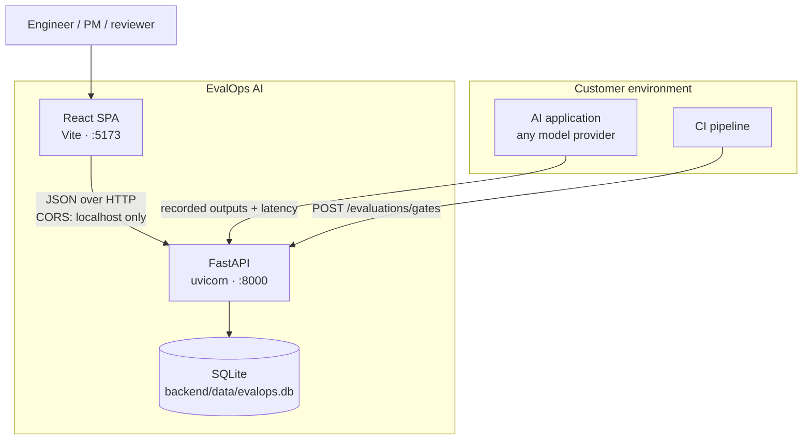
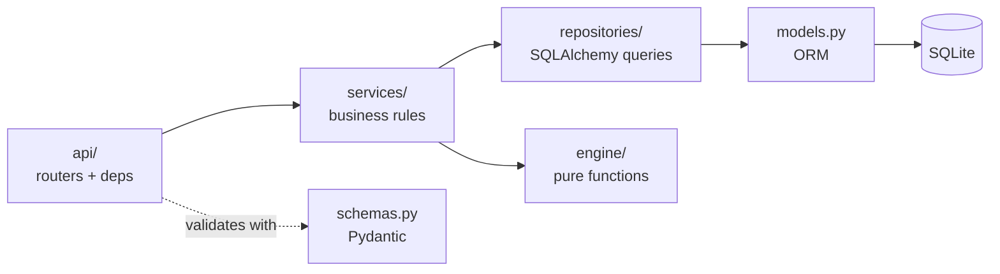
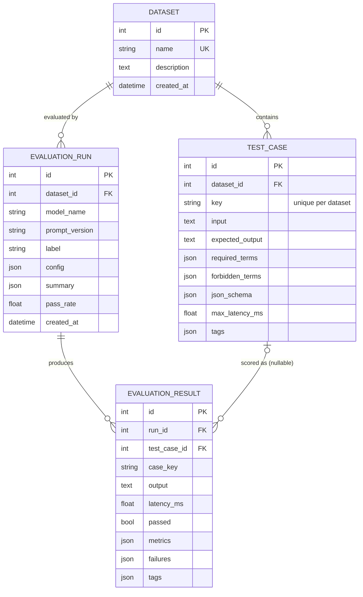
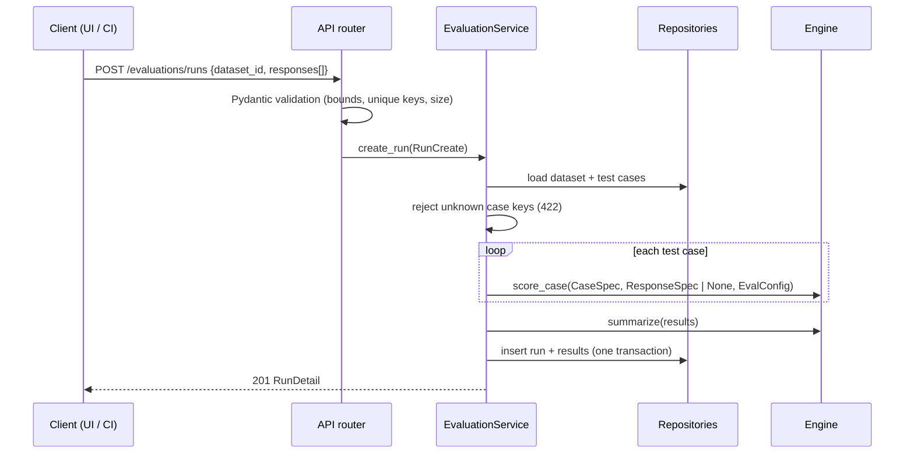

# Architecture

EvalOps AI is a small, layered monolith: a FastAPI service backed by SQLite and a React single-page app. Everything runs locally on a laptop with no containers and no external services.

## System context

EvalOps never calls a model. The customer's application (or a harness around it) produces outputs, and EvalOps scores them. This keeps the platform provider-agnostic, deterministic, and free to run.

## Backend layers

| Layer | Responsibility | Depends on |
|---|---|---|
| `api/` | HTTP routing, query/body parsing, status codes | services, schemas |
| `schemas.py` | Request/response contract and input validation (bounds, patterns, `extra="forbid"`) | engine (schema-definition check) |
| `services/` | Business rules: uniqueness, "dataset with runs can't be deleted", run scoring orchestration, report assembly, transactions | repositories, engine |
| `repositories/` | Persistence only, with no business rules | models |
| `engine/` | Metrics, scoring, aggregation, regression detection, gates. **No I/O, no ORM.** | stdlib + `jsonschema` |
| `errors.py` | Domain exceptions → consistent JSON error envelope; hides internals on 500 | — |

The engine is deliberately free of I/O so it is deterministic and unit-testable in isolation, and could later be packaged as a CLI or CI action without the web service.

## Data model

Design notes:

- **Results are snapshots.** A result stores `case_key`, tags, metrics and failures at evaluation time. Editing or deleting a test case later never rewrites history (`test_case_id` becomes `NULL` on delete).
- **Comparisons join on `case_key`**, not on IDs, so runs stay comparable across case edits.
- **Run summaries are stored** as JSON on the run. History pages and comparisons don't need to re-aggregate results.
- `RESTRICT` on `evaluation_runs.dataset_id` means a dataset can't be deleted while runs reference it; the service returns 409 with a clear message.
- Schema changes go through **Alembic**. `tests/integration/test_migrations.py` fails if the ORM and migrations drift apart. The API applies migrations on startup (`EVALOPS_AUTO_MIGRATE`).

## Request flow: creating a run

Comparison (`GET /evaluations/compare`), gates (`POST /evaluations/gates`) and reports (`GET /runs/{id}/report`) read stored runs and call `engine.regression.compare_runs` and `engine.gates.evaluate_gates`. They never re-score.

## Frontend

- React 19 + TypeScript (strict, `noUncheckedIndexedAccess`), React Router, Vite.
- `src/api/client.ts` is the single integration point. It is typed against `src/api/types.ts`, which mirrors `schemas.py`, and normalizes errors (including "backend not running") into `ApiError`.
- Every number in the UI comes from the API; there is no client-side mock data. The overview's aggregates come from `/datasets` and `/evaluations/runs`.
- Charts are hand-written SVG to avoid a heavyweight chart dependency on an 8 GB machine.
- Shareable state lives in the URL (`/compare?baseline=1&candidate=2`, `/reports?run=2&baseline=1`).

## Security posture (local MVP)

| Concern | Control |
|---|---|
| CORS | Allow-list from `EVALOPS_CORS_ORIGINS` (default: the Vite dev origin only); `*` is dropped; no credentials |
| Input validation | Pydantic bounds on every field, key/tag patterns, unknown fields rejected, JSON Schemas validated before storage |
| Payload size | Per-field limits plus a 10 MiB `Content-Length` cap (413) |
| Error leakage | 500s return a generic message; validation errors omit echoed input |
| Secrets | None required; `.env` is git-ignored; `.env.example` contains no secrets |
| SQL injection | SQLAlchemy parameterized queries only |
| Auth | **None.** The service binds to `127.0.0.1` and is intended for single-user local use. See the roadmap. |

Known gap: the body-size check relies on `Content-Length`. Chunked uploads without that header are bounded only by the per-field limits.

## Why these choices

| Choice | Reason |
|---|---|
| SQLite | Zero-ops, single file, plenty for thousands of runs; SQLAlchemy keeps a path to Postgres |
| Responses-in rather than calling models | $0 to run, deterministic, provider-agnostic, and no secrets to manage |
| Pure engine module | Reproducible scores, easy unit tests, reusable outside the API |
| Fail-closed gates | A release gate that passes because data was missing is worse than no gate |
| Stored summaries + snapshots | History stays stable when datasets evolve |
