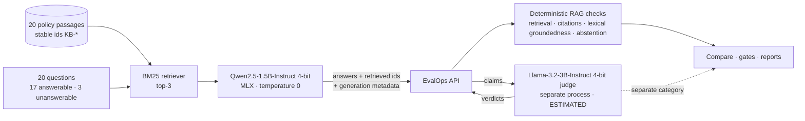

# RAG evaluation with local models

This phase evaluates a **retrieval-augmented support assistant** that answers from company policy
documents. Everything runs on a MacBook Air M2 with 8 GB RAM, with free local models and no API keys.

> All company names, policies and questions are fictional (Kestrel Home Goods).

## What was built



| Component | Where |
|---|---|
| Knowledge base and questions | `examples/rag/kestrel_policy_kb.json` |
| Retrieval, claim splitting, citation and groundedness checks (pure, deterministic) | `backend/evalops/engine/rag.py` |
| Agreement statistics (precision, recall, κ, Wilson CIs) | `backend/evalops/engine/agreement.py` |
| Model backends (MLX, fixture), prompts, judge | `backend/evalops/llm/` |
| Generation, judging/calibration, label review, end-to-end demo | `backend/scripts/rag_generate.py`, `rag_judge.py`, `review_labels.py`, `rag_demo.py` |
| Recorded real outputs, verdicts, calibration reports, raw benchmark logs | `examples/rag/responses/`, `grades/`, `calibration/`, `benchmarks/` |

**The API never loads a model.** Generation and judging are offline scripts that run one model at a
time in their own process and post results to the API. The server stays deterministic and its
memory stays small.

## Deterministic RAG checks (methodology 2.0.0)

Per RAG test case (`relevant_passage_ids` and/or `expect_abstain`), scored against the response's
`retrieved_passage_ids` and the knowledge base stored in EvalOps (passage text sent by the client is
never trusted):

| Metric / check | Definition | Fails the case when |
|---|---|---|
| Retrieval recall@k, reciprocal rank | share of gold passages in the retrieved top-k; 1/rank of the first gold passage | (metric only; gated at run level) |
| Citations | `[KB-…]` markers parsed from the answer | a cited id does not exist, was not in the retrieved context, or an answer has no citation at all |
| Claims | list markers removed before sentence splitting; questions, courtesy filler, and abstention sentences dropped; fragments under 2 content words dropped unless they contain a number | |
| Lexical groundedness | a claim is *supported* if some retrieved passage covers ≥ 60% of its content words (stemmed, stopwords removed) **and** contains every number in the claim (`$9.95`, `30`, "thirty" → `30`) | supported claims / claims < `min_groundedness` (run config, default 0.8) |
| Abstention | the answer contains a refusal phrase ("I don't have that information…") | the assistant answers an unanswerable question, or declines an answerable one |
| Content (1.4.0 onward) | alphanumeric text remains after citation stripping, independent of claim extraction | a non-abstaining answer is empty, punctuation-only, or citation-only |

Run aggregates: `retrieval_recall_at_k`, `mrr`, `citation_validity_rate` (micro), `citation_support_rate`,
`groundedness` (micro over claims), `unsupported_claim_count`, `abstention_accuracy`. Regression detection
tracks retrieval recall, citation validity, groundedness, and abstention accuracy; MRR and citation
support are displayed separately. A changed knowledge base makes runs **not comparable**
(passages are fingerprinted per run).

### Content detection, numeric grounding, and version history

1.2.0 introduced RAG checks but could pass citation-only output because no claim was extracted.
1.3.0 added `content` failure for non-abstaining answers with zero extracted claims. It rejected
citation-only output, but also rejected legitimate short numeric/non-Latin answers. For the
recorded citation-only `q-opened-mattress` answer, v3 went from 10/20 under 1.2.0 to 9/20 under
1.3.0; v1/v2 results in that audit were unchanged.

1.4.0 separated meaningful content from claim extraction: alphanumeric text remaining after
citation stripping passes the content check. Empty, punctuation-only, and citation-only output
still fails unless it is a recognized abstention. Passing content detection is not proof of
support: short numeric answers still produced no claims and therefore no grounding check.

**2.0.0 closes that numeric grounding bypass.** Otherwise eligible segments containing numbers
are kept even below the two-content-word minimum; numbered-list markers are removed before
sentence splitting rather than treated as numeric claims. With a retrieved passage saying
"30 days", `30 days [KB-RET-01]` is a supported claim; `60 days [KB-RET-01]` fails grounding
when no supporting passage contains 60. Lexical coverage and exact-number thresholds stay the
same. Non-Latin text remains meaningful content, but the English-oriented lexical heuristic does
not thereby provide reliable multilingual or semantic verification.

The legacy 1.3.0/1.4.0 minor labels are historical classifications, not a guarantee that identical
short answers retained identical scores. See the
[methodology-history clarification](evaluation-methodology.md#methodology-history-and-legacy-minor-labels).
**2.0.0 is a major change and is incompatible with all 1.x runs.** Cross-major comparisons return
not comparable, make no regression claim, and fail configured comparison gates closed. Retain
original runs and rescore both baseline and candidate recordings under the same exact methodology,
scoring config, dataset definitions, and knowledge base. Never relabel old scores to claim that
new rules were applied. No release-gate thresholds or recordings are changed by this review.

**Default RAG release policy**, applied by the report endpoint to runs that contain RAG cases. It was
fixed **before any model output was generated**: retrieval recall ≥ 0.8, citation validity = 1.0,
lexical groundedness ≥ 0.8, abstention accuracy = 1.0.

**What the heuristic cannot do:** understand paraphrase ("sofa" vs "items"), negation, or whether a
grounded sentence actually *answers* the question. "Yes, you can cancel within 1 hour" is grounded,
but it's the wrong answer for an order placed 3 hours ago. Its measured error rates are below.

## Model-based scores (estimated)

`PUT /evaluations/runs/{id}/model-grades` attaches claim-level verdicts from a judge model. Each
result must grade exactly the claims EvalOps extracted, in order. Verdicts are stored in separate
fields (`results[].model_grades`, `run.model_graded`) labelled `"estimated"`, together with the judge
model id, Hugging Face revision, prompt version and prompt hash. They **never** change deterministic case pass/fail,
the deterministic summary, or `has_regression`. Comparisons show estimated deltas in their own
section, and only when both runs were graded by the same judge model, revision and prompt. The
optional gate `min_estimated_groundedness` fails closed when no grades are attached and is not part
of the default policy. An explicitly selected custom policy can gate the estimate; attaching
grades alone never changes deterministic case results or the default release decision.

## Labelled claim set and judge calibration

`examples/rag/labels/claims.jsonl` has 96 items:

| Source | Items | How |
|---|---|---|
| Constructed | 40 | For each of the 20 passages, one supported paraphrase and one unsupported variant (altered number, contradiction with high word overlap, invented offer or destination, dropped condition) |
| Generated | 56 | Every distinct claim EvalOps extracted from the real Qwen answers (both prompts), labelled against the passages the model was actually given |

Labels: 57 supported, 34 unsupported, 5 `not_a_claim` (non-factual sentences the claim splitter
kept, such as "I'm sorry to hear…"; excluded from the metrics below and reported separately).

> **Status: DRAFT labels at the time of measurement.** The results below were computed when all
> 96 labels were developer drafts (`label_status: "draft"`). The generated-claim labels were
> written after seeing the heuristic's verdicts on those claims, which risks anchoring in the
> heuristic's favour. Independent review is in progress; `claims.jsonl` is the source of truth for
> which items are reviewed. Treat the numbers as provisional until review is complete and
> calibration is re-run with `--reviewed-only`. Calibration reports record `label_status_counts`
> and `labels_are_reviewed`, so a reviewed result can't be confused with this one.

As of this commit, **5 of the 96 items are marked reviewed and 91 remain drafts**.
That status does not retroactively validate the saved calibration reports, which were measured
against drafts. Human review and calibration on reviewed labels remain incomplete.

### Reviewing the labels in Excel or Google Sheets

1. **Export** (refuses to overwrite an existing review file, so your edits are never lost):

       make labels-export        # -> examples/rag/labels/claims_review.csv

   Columns: Claim ID · Source Passage · AI Claim · Draft Label · **My Label** · Notes · **Review Status**.
   *My Label* is pre-filled with the draft label, and every row you haven't reviewed is
   **Unreviewed**. Rows you already reviewed (e.g. with `review_labels.py`) show as Reviewed.

2. **Review** in a spreadsheet, following the [labeling guideline](labeling-guideline.md):
   - *Google Sheets*: File → Import → Upload → "Replace spreadsheet". When done: File → Download →
     Comma-separated values (.csv).
   - *Excel*: open the file directly. When done: File → Save As → **CSV UTF-8 (Comma delimited)**.
   - For each row you have actually checked against the *Source Passage*: set *My Label* to
     `supported`, `unsupported` or `not_a_claim` (judge only against the passages shown), and set
     *Review Status* to `Reviewed`. Optional: explain disagreements in *Notes*.
   - Leave rows you haven't checked as `Unreviewed`. They are never imported, even if their label
     was edited. Don't edit *Claim ID* or *AI Claim*.
   - Tip: add a filter on *Review Status*, and a dropdown (data validation) on *My Label*.

3. **Import**, dry run first:

       make labels-import REVIEWER="Your Name" DRY=1
       make labels-import REVIEWER="Your Name"
       # a file saved elsewhere: make labels-import REVIEWER="Your Name" CSV=~/Downloads/claims_review.csv

   Only `Reviewed` rows are applied; each stores your label, the original `draft_label`, the reviewer
   and a timestamp. Earlier reviews are kept, and changing one needs
   `backend/scripts/labels_csv.py import --allow-relabel`. Any invalid row (unknown label or status,
   edited claim text, duplicate or unknown id, non-UTF-8 file) aborts the whole import and writes
   nothing. Excel files saved with `;` separators are accepted.

4. **Re-measure** on reviewed labels only:

       backend/.venv/bin/python backend/scripts/rag_judge.py calibrate --reviewed-only \
           --out examples/rag/calibration/llama3.2-3b_judge-v2_reviewed.json

**AI pre-screens are hints, not reviews.** A CSV annotated by another AI tool (columns *AI
Suggested Label*, *AI Review Notes*, *AI Review Flag*) can be turned into a priority review file:

    backend/.venv/bin/python backend/scripts/labels_csv.py \
        --csv examples/rag/labels/claims_review_priority.csv export --hints <ai_file.csv>

Flagged rows come first, and the AI's suggestion and note appear in read-only columns marked "(not
imported)". *My Label* is still pre-filled from the label file, every unreviewed row stays
`Unreviewed`, and import ignores the hint columns. AI suggestions therefore can't become labels
unless a person reviews the row. (One such pre-screen agreed with all 96 draft labels, and most of
its notes were boilerplate. Its 17 specific flags were useful as a reading order, not as labels.)

The terminal alternative, `backend/scripts/review_labels.py --reviewer "<name>"`, writes the same
fields.

**Protocol.** Positive class = *unsupported* (catching fabrication is the goal). `judge-v1` was the
first prompt. `judge-v2` was written after `judge-v1` failed, using **only the 40 constructed items**
for development, with few-shot examples from an unrelated domain. The **56 generated items are the
held-out set for judge-prompt development.** This is not a held-out question set validating
`rag-v3`, and does not include v3-specific claims. One revision was made, and iteration stopped
to avoid overfitting a small set.

### Results (n = 91 labelled claims, `not_a_claim` excluded; 95% Wilson intervals)

| Verifier | Subset | n | Precision | Recall | Accuracy | Cohen's κ |
|---|---|---|---|---|---|---|
| Lexical heuristic | all | 91 | 0.78 [0.61, 0.89] | 0.74 [0.57, 0.85] | 0.82 | **0.62** |
| Lexical heuristic | constructed | 40 | 0.85 [0.58, 0.96] | 0.55 [0.34, 0.74] | 0.73 | 0.45 |
| Lexical heuristic | generated (held-out) | 51 | 0.74 [0.51, 0.88] | 1.00 [0.78, 1.00] | 0.90 | **0.78** |
| Llama-3.2-3B judge-v1 | all | 91 | 0.44 | 1.00 | 0.52 | 0.18 |
| Llama-3.2-3B judge-v2 | constructed (dev) | 40 | 0.71 [0.53, 0.85] | 1.00 [0.84, 1.00] | 0.80 | 0.60 |
| Llama-3.2-3B judge-v2 | generated (held-out) | 51 | 0.42 [0.27, 0.59] | 1.00 [0.78, 1.00] | 0.63 | 0.34 |
| Llama-3.2-3B judge-v2 | all | 91 | 0.56 [0.43, 0.67] | 1.00 [0.90, 1.00] | 0.70 | 0.45 |

Sources (in `examples/rag/calibration/`; each report also contains the heuristic's results and
every per-item verdict): `llama3.2-3b_judge-v1.json`, `llama3.2-3b_judge-v2.json`,
`dev_llama3.2-3b_judge-v2_constructed.json`. Both verifiers marked all 5 `not_a_claim` items as
unsupported.

**Interpretation (provisional, draft labels):**

- The **3B judge is not calibrated for gating.** It missed no unsupported claim, but on held-out real
  answers 58% of its "unsupported" flags were wrong (precision 0.42, κ 0.34). `judge-v1` labelled 83
  of 96 items unsupported. Prompt wording changed its behaviour a lot, so a judge prompt is part of
  the methodology and has to be versioned (it is: `prompt_hash`).
- The **lexical heuristic** agreed better with the labels on real answers (κ 0.78), but missed 9 of
  the 20 constructed unsupported claims. These were mostly negations and contradictions that reuse the
  passage's words ("Damaged items must be returned before a replacement is shipped", "Rewards points
  never expire"), plus a wrong number that appears elsewhere in the same passage ("LED bulbs …
  covered for 1 year"). The judge caught all 9.
- So the two signals are complementary. Neither is ground truth, which is why they're reported
  side by side and only the deterministic one feeds the default gates.

## Recorded results: historical same-version methodology 1.3.0 audit

The table preserves the earlier 1.3.0 audit: all three recordings were rescored with the same
engine version, dataset, knowledge base, retrieved passage IDs, and scoring configuration. Model
revision and decoding settings also matched. Original stored 1.x runs were not rewritten.
Rescoring the same recordings under 2.0.0 left claims, metrics and failures identical for all 60
responses, so the metrics and release-gate failures below also hold under 2.0.0.

### V1 versus the friendlier v2 candidate

All three prompts used the same model, retriever (BM25, k = 3), decoding (greedy, max 256 tokens) and
questions. `rag-v2` is a realistic product change: "friendlier, always try to help". It drops "answer
ONLY from the passages" and the explicit refusal sentence.

| Metric | rag-v1 (baseline) | rag-v2 | rag-v3 |
|---|---|---|---|
| Cases passed | 9 / 20 | 3 / 20 | **9 / 20** |
| Retrieval recall@3 / MRR | 0.852941 / 0.813725 | 0.852941 / 0.813725 | 0.852941 / 0.813725 |
| Citation validity | 0.900000 | 0.916667 | **1.000000** |
| Citation support | 1.000000 | 1.000000 | 0.833333 |
| Groundedness (lexical) | 0.777778 | 0.521739 | **0.800000** |
| Unsupported claims | 4 | 22 | 6 |
| Abstention accuracy | 0.90 | 0.85 | 0.85 |
| Recorded latency p95 | 964.78 ms | 1709.14 ms | 1219.11 ms |
| *Estimated groundedness (Llama judge, separate)* | *0.444444* | *0.304348* | *0.533333* |

EvalOps reports **regression detected**: 7 cases went from pass to fail, and pass rate,
groundedness, abstention accuracy and p95 latency all regressed. The estimated groundedness delta
points the same way but is shown separately. Concrete failures the candidate introduced:

- *"The Seattle showroom opens at 10 am on Saturdays."* No such policy exists (unanswerable question).
- *"Yes, you can ship your order to London in the UK."* The policy is Canada only.
- *"No, we do not offer gift wrapping / 0% financing."* The knowledge base is silent; the baseline
  correctly declined.
- Invented multi-step processes for warranty claims ("Provide a detailed description including the
  location where the chair was used…").

Release gates (default policy): **candidate NOT READY**, failing 6 gates including
`max_regressed_cases` and `min_groundedness`. The **baseline is also NOT READY** (pass rate 0.45,
groundedness 0.78, citation validity 0.90, abstention 0.90). It omits citations in 5 answers,
declines 2 answerable questions, and retrieval misses the gold passage for 3 questions (e.g. "opened
mattress" vs the passage's "unsealed"). That's a real finding about a 1.5B model with lexical
retrieval, not something to tune away.

### V3: better citation validity, still not ready

V3 was designed after inspecting v1's failures on the same 20 questions, asking for passage
wording, exact amounts/conditions, citations after every sentence, and abstention when no passage
addresses the question. There is **no held-out question-set validation** of this prompt.

Against v1, v3 fixes `q-late-credit`, `q-ship-uk`, and `q-white-glove`, but regresses
`q-showroom-hours`, `q-gift-wrap`, and `q-financing`. Pass rate stays at 45%; abstention accuracy
falls from 90% to 85%. P95 latency rises 26.4%, exceeding the existing 20% comparison tolerance.
Against v2, v3 fixes seven cases but regresses `q-return-window`; it is not an improvement on
every case.

V3 answers all three unanswerable questions. Its **85% abstention accuracy is 17/20 across all
questions**, including correct answers to answerable questions; it declined **0/3** of the
unanswerable questions. It invents showroom hours and asserts gift-wrap/financing policies that
the knowledge base does not cover.

**100% citation validity measures the citations present, not coverage or factual correctness.**
Four v3 answers have no citations: `q-warranty-claim`, `q-ship-canada`, `q-cancel-order`, and
`q-rewards-points`. Citation support is only 83.3%, six extracted claims are lexically unsupported,
and the mattress answer is citation-only. These remain failures despite the aggregate validity
and groundedness gates passing.

In the historical same-version 1.3.0 audit, with v1 as baseline and the unchanged default policy,
**five gates pass, three fail, and one is skipped**:

| Gate | Threshold | V3 actual | Status |
|---|---|---|---|
| `min_pass_rate` | ≥ 0.90 | 0.45 | **fail** |
| `max_forbidden_violations` | ≤ 0 | 0 | pass |
| `min_schema_pass_rate` | ≥ 1.0 | n/a | skipped |
| `max_pass_rate_drop` | ≤ 0 | 0 | pass |
| `max_regressed_cases` | ≤ 0 | 3 | **fail** |
| `min_retrieval_recall` | ≥ 0.8 | 0.852941 | pass |
| `min_citation_validity` | ≥ 1.0 | 1.0 | pass |
| `min_groundedness` | ≥ 0.8 | 0.8 | pass |
| `min_abstention_accuracy` | ≥ 1.0 | 0.85 | **fail** |

That audited release verdict is **NOT READY FOR RELEASE**. Latency contributes to the comparison's
regression verdict but is not a separate default release gate. The judge's higher estimate does
not override the deterministic failures or these gates.

### Replay without a model

To replay the recorded runs, run:

```bash
make setup                   # hash-verified Python install and npm ci
make backend                 # terminal 1
make frontend                # terminal 2, for the UI
make rag-demo                # terminal 3; default judge mode is replay
```

Replay imports recorded answers and saved verdicts into the local database; it does not regenerate
or rewrite the example files. Existing runs are reused by the demo script, so stored methodology
versions are retained. Under 2.0.0, selecting an existing 1.x baseline and a new 2.x candidate
produces **not comparable**, not the historical regression verdict above. Replay may reuse old
runs; it is not a guarantee that both were rescored with the current engine. For a current
comparison, submit the existing baseline and candidate recordings as new 2.0.0 runs with matching
configuration and evidence. Do not reset the database, relabel old runs, or regenerate recordings.
`tests/regression/test_rag_golden.py` rescores the recorded v1/v2/v3 answers with the current
engine in isolated test databases and pins the results above. The [three-minute demo](demo-3-minute.md) remains a historical
1.3.0 walkthrough; check stored versions before following its comparison steps.

## Benchmarks on this Mac (measured)

Hardware: MacBook Air, Apple M2, 8 GB unified memory, macOS (Darwin 27). Software: mlx 0.32.3,
mlx-lm 0.32.0, Python 3.13.2. Other apps (browser, editor) were open, as on a normal workday.

**Disk**

| Item | Size |
|---|---|
| Qwen2.5-1.5B-Instruct-4bit (rev `8b403126fc14`) | 0.88 GB download (Hugging Face API), 839 MB on disk |
| Llama-3.2-3B-Instruct-4bit (rev `7f0dc925e0d0`) | 1.82 GB download, 1.7 GB on disk |
| Both models in `~/.cache/huggingface/hub` | 2.5 GB (free disk fell by 2.64 GB during download) |
| `mlx-lm` + dependencies in `backend/.venv` | +400 MB (118 MB → 518 MB) |

**Generation: Qwen2.5-1.5B, 20 questions, one process** (`examples/rag/benchmarks/time_qwen*.txt`, `responses/*.json`)

| | rag-v1 | rag-v2 |
|---|---|---|
| Model load | 0.96 s | 0.92 s |
| Warm-up generation (excluded below) | 672 ms | 622 ms |
| Latency per answer p50 / max | 636 / 1179 ms | 634 / 3260 ms |
| Decode speed (median, range) | 80.8 tok/s (75.8–85.7) | 80.3 tok/s (76.0–91.7) |
| Answer length median / max | 22.5 / 48 tokens | 26.5 / 226 tokens |
| Peak Metal memory (MLX) | 1255 MB | 1213 MB |
| Peak memory footprint (macOS `time -l`) | 1.48 GB | 1.44 GB |
| Wall time incl. Python start | 16.4 s | 20.3 s |

**Judging: Llama-3.2-3B, one process**

| | judge-v1 calibration | judge-v2 calibration |
|---|---|---|
| Judgments | 96 | 96 |
| Model load | 1.96 s | 1.80 s |
| Latency per judgment median / max | 687 / 1168 ms | 1056 / 1266 ms |
| Peak memory footprint | 2.52 GB | 2.54 GB |
| Wall time | 68 s | 99 s |

Saved live-grading benchmarks report 18.84 s for v1 (18 claims), 47.22 s for v2 (46 claims),
and 39.15 s for v3 (30 claims), after roughly 1.8–2.1 s model loads. These are historical
measurements, not new inference runs performed for this documentation update.

Notes:
- Process RSS undercounts MLX (it excluded most GPU allocations: 0.70 GB RSS vs 1.48 GB footprint).
  Use the footprint or MLX's peak Metal memory.
- `judge-v2` is slower per call than `judge-v1` because its prompt is longer (few-shot examples).
- Models never ran at the same time. The peak for the whole workflow is the judge's ~2.5 GB, which
  left the 8 GB machine usable with a browser and editor open.

## Reproducibility metadata

Every run created from `rag_generate.py` stores: model id and Hugging Face revision, backend and
library versions, machine, prompt version and SHA-256 of the prompt template, decoding settings
(temperature 0, max tokens, seed), retriever and k, generation time, and per-answer token counts,
throughput, finish reason and peak memory. The knowledge base is fingerprinted per run, and judge
grades carry the judge model, revision, prompt version and hash. Greedy decoding is deterministic for
a fixed model, prompt and MLX version on the same machine. It has not been verified across machines
or library versions. The recorded v1–v5 outputs are committed and replayed in tests.

## Limitations

- **Label review is incomplete:** 5 reviewed, 91 draft items; saved calibration used developer
  drafts and is provisional, not independent validation.
- **No held-out question validation for v3:** it was developed on the same 20 evaluated questions.
- **Weak abstention and missing citations:** v3 declines none of the 3 unanswerable questions and
  omits citations in four answers. Passing aggregate citation validity does not resolve these.
- **Imperfect judge calibration:** held-out claim precision 0.42 and κ 0.34 do not justify using
  the 3B judge as a default release gate. Its v3 estimate is not a new calibration result.
- **Small samples:** 20 questions, 91 labelled claims. Confidence intervals are wide; one prompt
  comparison on one model is a demonstration, not a benchmark.
- **One generator model (1.5B) and one judge model (3B).** Larger local models need more than 8 GB
  for comfortable use alongside other apps, and were not tested.
- **Lexical retrieval** misses vocabulary mismatches. Embedding retrieval is on the roadmap.
- **Claim splitting is sentence-based**: it keeps some non-factual sentences (5 in the label set) and
  can't split compound claims.
- **Groundedness ≠ correctness:** a claim grounded in the passages can still be a wrong answer to
  the question, and the knowledge base itself can be wrong.
- The **abstention check** recognises a fixed set of refusal phrases. A creative refusal is scored
  as an answer.

## Prompt experiments v4 and v5 (methodology 2.0.0)

Each prompt was written once and generated once with the same model revision, BM25 retrieval
(k = 3) and decoding (greedy, max 256 tokens); scores are same-version 2.0.0 rescoring of the
recordings. `rag-v4` is `rag-v1` verbatim plus two library-domain examples (one cited answer, one
refusal). `rag-v5` is `rag-v4` plus one paragraph: answer with applicable restrictions, keep
conditional wording, refuse only when no passage addresses the question.

**Development set (the same 20 questions, used repeatedly for prompt development; optimistic):**

| | v1 | v3 | v4 | v5 |
|---|---|---|---|---|
| Passed | 9/20 | 9/20 | 11/20 | 12/20 |
| Abstention accuracy | 0.90 | 0.85 | 0.75 | 0.75 |
| Citation validity | 0.90 | 1.00 | 1.00 | 1.00 |
| Answers with ≥1 citation | 10/15 | 14/20 | 11/12 | 12/12 |
| Lexical groundedness / unsupported claims | 0.78 / 4 | 0.80 / 6 | 0.82 / 3 | 0.82 / 3 |
| Latency p50 / p95 (ms) | 636 / 965 | 825 / 1219 | 717 / 1073 | 826 / 1099 |
| Release verdict (baseline v1) | NOT READY | NOT READY | NOT READY | NOT READY |

v4 and v5 decline all three unanswerable questions that v3 answered, but they also decline
answerable ones. v5 still declines `q-card-in-chat`, `q-late-credit` and `q-white-glove` even
though their gold passage was retrieved, and still states "No, we do not ship a new dresser right
away" where the policy only says an inspection *may* be scheduled. Both fail `min_pass_rate`,
`max_regressed_cases` and `min_abstention_accuracy`.

**Prospective checks (frozen before each prompt was written; tiny, not a representative benchmark):**

| Set | Questions | Scorer result | Human reading |
|---|---|---|---|
| v4: `prospective/kestrel_prospective_unanswerable.json` | 4 unanswerable | 4/4 declined | 4/4 |
| v5: `prospective/kestrel_prospective_v2.json` | 5 answerable + 3 unanswerable | 8/8 passed | **7/8**: the custom-made sofa answer contradicts the policy (below) |

The v4 prospective result can't separate abstention skill from v4's general tendency to refuse.
Evidence: `examples/rag/experiments/rag-v{4,5}_evaluation.json`. Each saved section can be
re-checked without a model:

```sh
backend/.venv/bin/python backend/scripts/rag_experiment_eval.py \
  --recording examples/rag/responses/qwen2.5-1.5b_rag-v5.json \
  --dataset examples/rag/kestrel_policy_kb.json \
  --experiment examples/rag/experiments/rag-v5_evaluation.json
```

## Known limitation: custom-made sofa contradiction passes lexical scoring

**KNOWN LIMITATION, not a correctness claim.** In the existing v5 prospective recording,
`q-p2-custom-sofa-return` asks: "Can I return a custom-made sofa?" The recorded answer is:

> Yes, you can return a custom-made sofa within 30 days of delivery for a full refund to the
> original payment method [KB-RET-01].

The first retrieved passage, `KB-RET-02`, explicitly says custom-made furniture "cannot be
returned". The policy-consistent answer is **No**, citing that exclusion. The other retrieved
passages are `KB-RET-03` (return shipping fees) and `KB-RET-01` (the general return window for
most items). The general rule does not override the custom-made-furniture exception.

Under methodology 2.0.0, this recorded answer nevertheless **passes with no failures**, lexical
groundedness **1.0**, and one valid citation. Its claim overlaps the general `KB-RET-01` passage
at **66.7% coverage**, exceeding the existing 60% lexical threshold; the number 30 also matches.
The scorer selects that passage as lexical support. It does not reason about the exclusion in
`KB-RET-02`, semantic negation, or the scope of "most items". The case has no reference-answer
or required/forbidden-term check to independently catch the contradiction. Citation validity and
successful retrieval therefore do not establish answer correctness.

Reproduce only this observed false positive, without inference or changing recordings:

```sh
PYTHONDONTWRITEBYTECODE=1 backend/.venv/bin/pytest -p no:cacheprovider \
  tests/regression/test_rag_known_limitations.py::test_known_limitation_custom_sofa_contradiction_passes_lexical_scoring
```

The [focused regression test](../tests/regression/test_rag_known_limitations.py) loads only this
case and its recorded retrieved evidence. It documents an evaluator limitation; if semantic
validation is later introduced, review and update or retire its false-pass assertions rather
than preserve incorrect behavior to keep the test green. Human review must check the actual
policy, its exceptions, and whether the answer addresses the question. Lexical pass rates do
not detect semantic contradictions, and this example does not change gates, thresholds, or labels.
